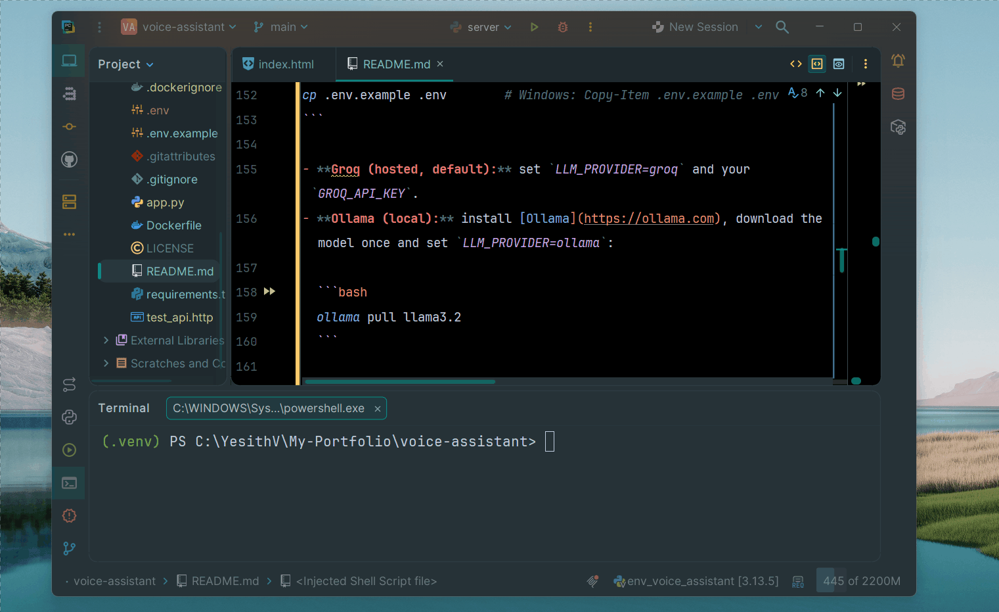
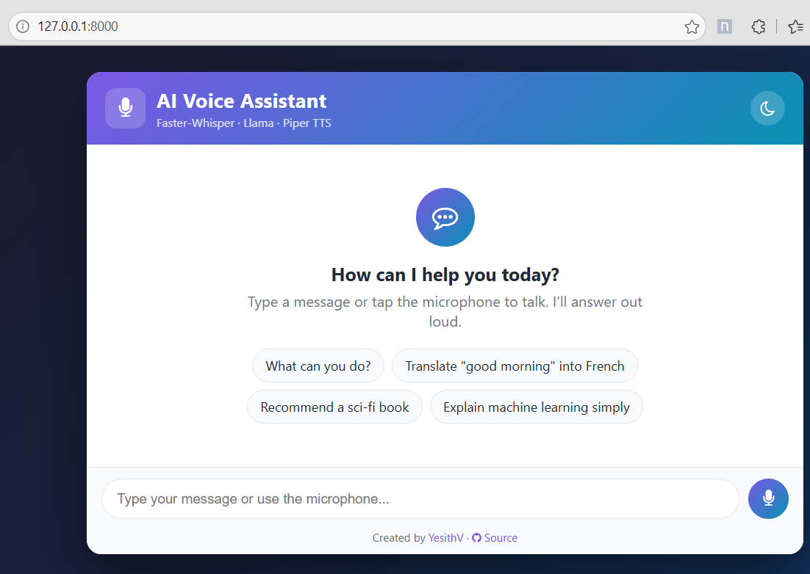
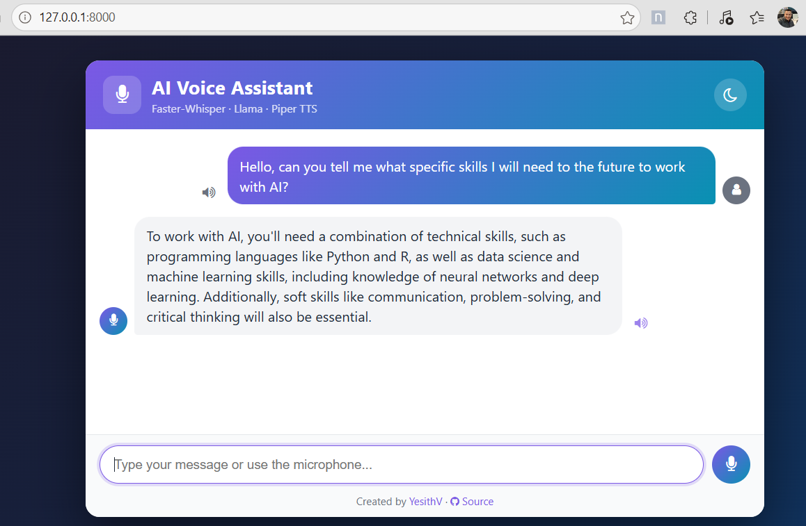
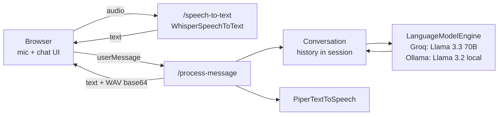

# 🎙️ AI Voice Assistant


## 1. Overview

A voice-enabled personal assistant built with Python and Flask. You can talk to it
through the microphone or type a message, and it answers both in text and with a
synthesized voice. It can answer questions, translate sentences, summarize topics and
give recommendations, keeping a short conversational memory per user.

The pipeline combines three AI models:

1. **Speech-to-Text** – [Faster-Whisper](https://github.com/SYSTRAN/faster-whisper) transcribes the recording locally.
2. **Language Model** – Llama generates the reply, either hosted ([Llama 3.3 70B on Groq](https://console.groq.com/docs/models)) or fully local ([Llama 3.2 on Ollama](https://ollama.com/library/llama3.2)).
3. **Text-to-Speech** – [Piper](https://github.com/rhasspy/piper) turns the reply into natural speech locally.

The project started as a practice exercise from an IBM Skills Network course that relied
on hosted IBM Watson Speech services and OpenAI. It was later refactored to run speech
recognition and synthesis fully locally, with each model behind a common interface so it
can be swapped without touching the web layer.

## 2. Features

- Voice **and** text input from a clean web chat UI with light/dark mode.
- Spoken replies that play automatically, plus replay buttons for every message.
- Short-term conversational memory (last 3 exchanges), isolated per user through a signed session cookie.
- JSON REST API (`POST /speech-to-text`, `POST /process-message`) that other clients can consume.
- Pluggable engines through abstract `SpeechToTextEngine`, `LanguageModelEngine` and `TextToSpeechEngine` interfaces.
- Switch between a hosted LLM (Groq) and a 100% local one (Ollama) with a single environment variable.
- Input validation and friendly error messages (busy provider, unintelligible audio, invalid input).
- Model output is always rendered as text, never as HTML, to prevent XSS.
- Unit tests for the conversation logic, the Flask routes and the Ollama client, with every model mocked.
- Docker image with the models baked in, served by Gunicorn as a non-root user.

## 3. Demo

### Voice conversation



### Empty state with suggestions



### Example conversation



## 4. Architecture

The Flask layer depends only on `Conversation` and the three engine abstractions; the
concrete implementations are injected in `create_default_app()`.



Request flow:

1. The user records a message (or types it and presses Enter).
2. `script.js` sends the audio blob to `POST /speech-to-text`; Faster-Whisper decodes it in memory (WebM/Ogg/WAV via PyAV) and returns the transcription.
3. The text is sent to `POST /process-message` as `{ "userMessage": "..." }`.
4. `app.py` validates the input and restores the user's history from the session cookie.
5. `Conversation` builds the chat messages (system prompt + history + new message) and calls the configured language model (Groq or Ollama).
6. Piper synthesizes the reply into a WAV file, which is returned base64-encoded together with the text.
7. The browser renders the reply and plays the audio.

## 5. Tech Stack

| Layer          | Technology                                              |
|----------------|---------------------------------------------------------|
| Backend        | Python, Flask, Flask-CORS, Gunicorn (Docker)            |
| Speech-to-Text | Faster-Whisper (CTranslate2, int8 on CPU)               |
| LLM            | Llama 3.3 70B via the Groq API, or Llama 3.2 locally via Ollama |
| Text-to-Speech | Piper TTS (ONNX Runtime), `en_US-lessac-medium` voice   |
| Frontend       | HTML, CSS, jQuery, MediaRecorder API                    |
| Testing        | unittest                                                |
| Deployment     | Docker                                                  |

## 6. Project Structure

```
voice-assistant/
├── app.py                          # Flask app factory and routes
├── requirements.txt
├── Dockerfile
├── .env.example                    # Environment variables template
├── test_api.http                   # Sample HTTP requests (VS Code REST Client)
├── assets/                         # Screenshots and GIF used in this README
├── scripts/
│   └── download_models.py          # Downloads the Piper voice and caches Whisper
├── voice_assistant/
│   ├── engines.py                  # STT / LLM / TTS interfaces + ProviderError
│   ├── conversation.py             # System prompt + rolling history
│   └── implementations/
│       ├── whisper_stt.py          # Faster-Whisper speech recognition
│       ├── groq_llm.py             # Groq chat completions (hosted)
│       ├── ollama_llm.py           # Ollama chat API (local)
│       └── piper_tts.py            # Piper speech synthesis
├── static/
│   ├── css/style.css
│   └── js/script.js
├── templates/
│   └── index.html
└── tests/
    ├── test_app.py
    ├── test_conversation.py
    └── test_ollama_llm.py
```

## 7. Models

| Component | Model                                                                                              | Runs    | Notes                                                    |
|-----------|----------------------------------------------------------------------------------------------------|---------|----------------------------------------------------------|
| STT       | [Systran/faster-whisper-small](https://huggingface.co/Systran/faster-whisper-small)                | Local   | int8 quantization, VAD filter to skip silence            |
| LLM       | `llama-3.3-70b-versatile`                                                                          | Groq    | `max_tokens=200`, `temperature=0.7`, answers in 2–3 sentences |
| LLM       | [`llama3.2`](https://ollama.com/library/llama3.2) (3B, ~2 GB)                                      | Local   | Same settings via Ollama (`num_predict=200`), no data leaves the machine |
| TTS       | [rhasspy/piper-voices – en_US-lessac-medium](https://huggingface.co/rhasspy/piper-voices)          | Local   | ~63 MB ONNX voice, 22.05 kHz WAV output                  |

- The Whisper size (`small`, `medium`, `large-v3`...) and the Groq/Ollama models can be changed through environment variables.
- Models are loaded once at startup, not on every request. With Ollama on CPU, the first reply takes a few extra seconds while the model is loaded into memory.
- `truststore` is used so model downloads and API calls also work behind corporate proxies that perform SSL inspection.

## 8. Running Locally

Prerequisites: Python 3.10+, `pip` and either a free [Groq API key](https://console.groq.com/keys) or [Ollama](https://ollama.com) installed locally.

```bash
git clone https://github.com/yesithv/voice-assistant.git
cd voice-assistant

python -m venv .venv

# Windows
.venv\Scripts\activate

# Linux / macOS
source .venv/bin/activate

pip install -r requirements.txt
python scripts/download_models.py   # one-time: Piper voice (~63 MB) + Whisper small (~480 MB)
```

Create your `.env` from the template and choose the language model provider:

```bash
cp .env.example .env        # Windows: Copy-Item .env.example .env
```

- **Groq (hosted, default):** set `LLM_PROVIDER=groq` and your `GROQ_API_KEY`.
- **Ollama (local):** install [Ollama](https://ollama.com), download the model once and set `LLM_PROVIDER=ollama`:

  ```bash
  ollama pull llama3.2
  ```

| Variable           | Default                                   | Description                                   |
|--------------------|-------------------------------------------|-----------------------------------------------|
| `LLM_PROVIDER`     | `groq`                                    | `groq` or `ollama`                            |
| `GROQ_API_KEY`     | –                                         | Groq API key (required when using Groq)       |
| `GROQ_MODEL`       | `llama-3.3-70b-versatile`                 | Any Groq-hosted chat model                    |
| `OLLAMA_HOST`      | `http://localhost:11434`                  | Ollama server URL                             |
| `OLLAMA_MODEL`     | `llama3.2`                                | Any model pulled into Ollama                  |
| `WHISPER_MODEL`    | `small`                                   | `tiny`, `base`, `small`, `medium`, `large-v3` |
| `PIPER_MODEL_PATH` | `models/tts/en_US-lessac-medium.onnx`     | Path to the Piper `.onnx` voice               |
| `SECRET_KEY`       | random on each start                      | Signs the session cookie                      |
| `PORT`             | `8000`                                    | Port for `python app.py`                      |

Start the app:

```bash
python app.py
```

Open [http://localhost:8000](http://localhost:8000) and allow microphone access.

To add a new engine, create a class that inherits from the matching interface in
[voice_assistant/engines.py](voice_assistant/engines.py) and pass an instance to
`create_app()` in [app.py](app.py).

## 9. Running with Docker

```bash
docker build -t voice-assistant .
docker run --rm -p 8000:8000 --env-file .env voice-assistant
```

The image downloads the Piper voice and the Whisper model at build time, so the
container starts without network access to Hugging Face. Use
`--build-arg WHISPER_MODEL=base` for a smaller image.

To use Ollama running on the host, point the container to it:

```bash
docker run --rm -p 8000:8000 --env-file .env \
  -e LLM_PROVIDER=ollama -e OLLAMA_HOST=http://host.docker.internal:11434 voice-assistant
```

## 10. Running Tests

```bash
python -m unittest discover tests
```

All models are replaced with fakes (and the Ollama HTTP API with `httpx.MockTransport`),
so the tests run in milliseconds without downloading anything or calling any AI service.

## 11. API

### `POST /speech-to-text`

Body: raw audio bytes (any format FFmpeg can decode, e.g. `audio/webm`, `audio/wav`). Max 10 MB.

| Status | Body                                          |
|--------|-----------------------------------------------|
| 200    | `{ "text": "What's the weather like?" }`      |
| 400    | `{ "error": "No audio received. ..." }`       |
| 422    | `{ "error": "Sorry, I couldn't understand the audio. ..." }` |

### `POST /process-message`

| Field         | Type   | Required | Description                     |
|---------------|--------|----------|---------------------------------|
| `userMessage` | string | Yes      | User message (1–500 characters) |

Success (`200 OK`):

```json
{
  "aiResponseText": "Buenos días is how you say good morning in Spanish.",
  "aiResponseSpeech": "UklGRiQAAABXQVZFZm10..."
}
```

`aiResponseSpeech` is a base64-encoded WAV file. Errors return `{ "error": "..." }` with
`400` (invalid input), `503` (provider unreachable, rate-limited or overloaded), `502`
(provider rejected the request or returned an error) or `500`.

Example:

```bash
curl -X POST http://localhost:8000/process-message \
     -H "Content-Type: application/json" \
     -d '{"userMessage": "Translate good morning into Spanish"}'
```

## 12. What I Learned

- Building an end-to-end voice pipeline (STT → LLM → TTS) and keeping latency low by loading models once and running Whisper with int8 quantization.
- Capturing microphone audio in the browser with the MediaRecorder API and decoding it in memory on the server.
- Replacing hosted IBM Watson services with local open-source models (Faster-Whisper, Piper) and choosing between a fast hosted LLM (Groq) and a private local one (Ollama).
- Managing conversational context with OpenAI-style messages and a sliding window stored in a signed session cookie.
- Applying the Strategy pattern with abstract base classes so each model can be swapped independently.
- Handling provider errors (rate limits, overloads) gracefully without leaking internal details.
- Testing ML-backed applications by mocking every model, and containerizing them with models baked into the image.

## 13. Future Improvements

- Stream the LLM reply and synthesize audio sentence by sentence to reduce time-to-first-sound.
- Multi-language support (auto-detect the spoken language and pick a matching Piper voice).
- Let the user choose between several Piper voices.
- Show which LLM provider is active in the UI.
- Deploy to Hugging Face Spaces or Render.

## License

This project is licensed under the [MIT License](LICENSE).

## Author

**Yesith Valencia** — Software Engineer passionate about AI, Generative AI, and Cloud Technologies.

[GitHub Portfolio](https://yesithv.github.io/)

